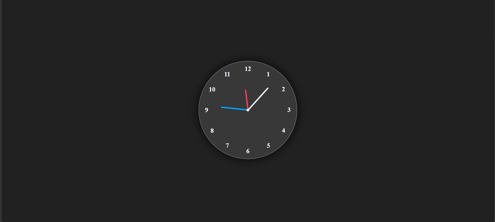

🕒 Analog Clock

  <strong>A Modern Real-Time Analog Clock</strong>

  A beautiful analog clock built using HTML, CSS, and JavaScript, featuring smooth animations, colorful clock hands, and a modern glassmorphism design.

⸻

🖼️ Project Preview

  

⸻

✨ Features

* ⏰ Real-Time Clock – Displays current hours, minutes, and seconds.
* 🔄 Automatic Updates – Clock hands move according to real time.
* 🎨 Modern UI – Beautiful glassmorphism design with glowing effects.
* 🌈 Colorful Hands – Different colors for hour, minute, and second hands.
* 📱 Responsive Design – Compatible with mobile and desktop screens.
* ⚡ Smooth Animation – Continuous movement of clock hands.

⸻

🛠️ Technologies Used

  
  
  

⸻

🚀 How to Run

1. Clone this repository.
2. Open the project folder.
3. Open index.html in your browser.
4. Enjoy your analog clock!

⸻

👨‍💻 Developer

NUAM

  ⭐ If you like this project, consider giving it a star!

